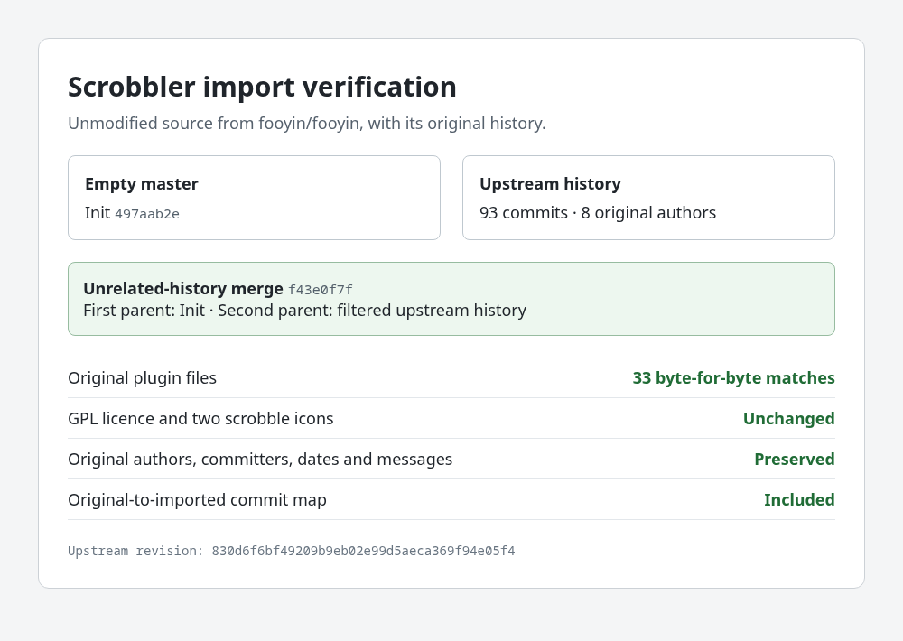

# fooyin-scrobbler

The Scrobbler plugin from [fooyin](https://github.com/fooyin/fooyin), imported unchanged from [830d6f6bf492](https://github.com/fooyin/fooyin/commit/830d6f6bf49209b9eb02e99d5aeca369f94e05f4). The original source files, icons, copyright notices and GPL-3.0-or-later licence are preserved.

The import retains 93 upstream commits by 8 authors, including the original author and committer dates and commit messages. Filtering rewrites commit IDs; [the commit map](docs/upstream-commits.tsv) links them to the original history.

The filtered history joins the empty `Init` commit through an unrelated-history merge. Standalone build integration and feature changes are separate from this baseline.

